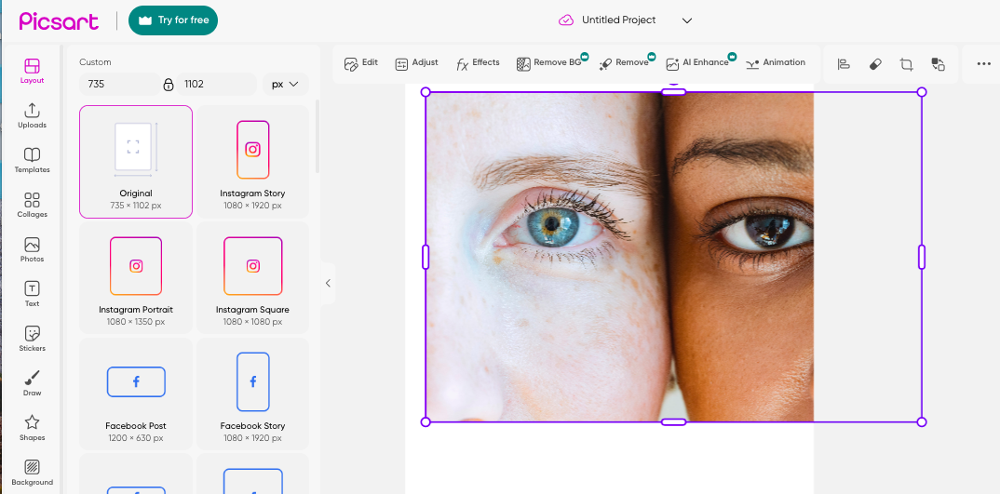
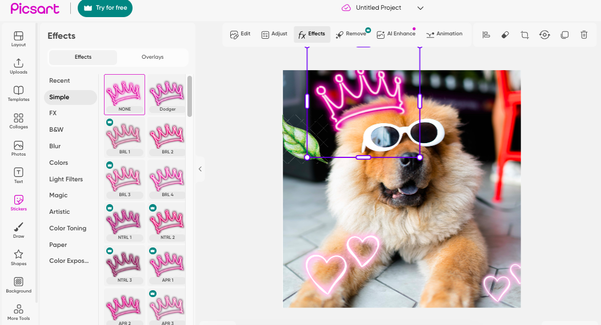
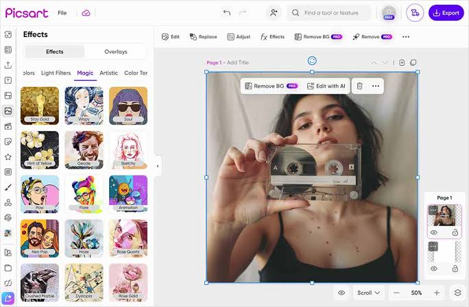

# PicsArt AI Photo Editor

PicsArt AI Photo Editor is a photo editor, a video editor, and a design board in one product. You open a picture, change it, and post it.

PicsArt AI is the generation and cleanup side: chat a picture into existence, lift a background, erase an object, or stretch the frame. The picsart photo editor is the hands-on side: layers, brushes, text, and filters.

picsart photo studio is that same work on a phone, in a browser, or on Windows 10 and Windows 11. A Google Workspace add-in exists too. This page does not quote a price.

## Overview

- Layer edits, background removal, and object erasure.
- AI enhance, retouch, and smart expand.
- Image to video, plus templates, stickers, and fonts.
- A free plan with core tools and a limited pool of AI credits.
- Plus and Pro for a full credit balance, premium templates, advanced retouch, team seats, and no ads.

| Plan | What is included |
| --- | --- |
| Free | Core editing, templates, limited AI credits |
| Plus and Pro | Full AI credits, premium templates, advanced retouch, team seats, ad-free workspace |

A layer you paint on is [UserLayer.cs](UserLayer.cs). The layer record is [gimplayer.h](layer/gimplayer.h). The stack of those layers is [gimplayerstack.h](layer/gimplayerstack.h).

The canvas banner is the open picture with the tool row above it, not a logo. Start there. Do not export until the crop looks right.

## What makes it different

The product is built around AI tools and a large asset library, not around a single filter. picsart flow is the path from a blank board to a finished post: a template, your photo, a sticker, then export.

### Lightweight and completely portable

You can start in the browser without installing a desktop build. Phones cover iOS and Android. Windows 10 and Windows 11 have a desktop build. The browser session is not a substitute for every desktop control, and the phone build is not a substitute for a wide canvas.

### Integrated macro recording and batch processing

A batch pass repeats one job across many files: a crop, a background removal, or an export size. This page does not describe a macro recorder. Run the batch on copies if you still need the originals.

The export writer for a JPEG is [JpegFormat.cs](export/JpegFormat.cs). The batch runner is [BatchProcessor.bas](export/BatchProcessor.bas).

### Usability is paramount

Name the layer before you add a fifth one. A sticker and a text line should not share a layer with the photo. Undo is there. It is not a reason to skip a duplicate of the original file.

The brush tool is [Paintbrush.bas](brush/Paintbrush.bas). The tool list is [ToolManager.cs](brush/ToolManager.cs). The brush shape is [gimpbrush.h](brush/gimpbrush.h).

### Pro-grade features and tools

- [x] Background removal and object erasure
- [x] AI enhance, retouch, and smart expand
- [x] Image to video
- [x] Templates for posts, ads, and collages
- [x] Stickers and fonts
- [x] PicsArt AI chat that turns a sentence into a picture

The layer editor is the stack: photo, cutout, text, sticker. Hide a layer instead of deleting it when you are still comparing two versions.

Color work sits in [Filters_Color.bas](filter/Filters_Color.bas). A blur is [GaussianBlurEffect.cs](filter/GaussianBlurEffect.cs). The filter record is [gimpfilter.h](filter/gimpfilter.h). Red eye cleanup is [RedEyeRemoveEffect.cs](filter/RedEyeRemoveEffect.cs).

### Limitations

The free plan does not include the full AI credit balance. Premium templates, advanced retouch, team seats, and an ad-free workspace are Plus and Pro. A generated frame can miss a hand or a letter. Look at it before you post it.

A phone screen is a narrow canvas. A collage with six frames is easier on Windows or in the browser. Move the file there if the phone crop keeps eating the edges.

Curves are [CurvesEffect.cs](adjust/CurvesEffect.cs). Brightness and contrast are [BrightnessContrastEffect.cs](adjust/BrightnessContrastEffect.cs).

### Recent changes and updates

This page does not pin a version number. The stores and the publisher site carry the current build. A screenshot from an old tutorial can show a button that has moved.

Credits spent on a generation are not refunded by this page. If the picture is wrong, change the sentence and try again while you still have credits left on the plan you chose.

## Icons are from

Templates, stickers, and fonts come with the product. The sticker library is large, on the order of tens of millions of items. A template is a starting layout, not a finished ad until you replace the sample photo.

The sticker grid is that library in rows. Drop one sticker. Do not cover the face you meant to show.

Text on the canvas is [TextTools.bas](text/TextTools.bas).

## Web Resources

Use the publisher site for the build you want: phone, browser, or Windows. A video of someone else's edit is not the download. The support desk is the publisher's help center, not this page.

## Discussion Channels

Questions about a failed export or a missing credit belong with the publisher. This page does not host a chat room and does not collect account passwords.

## Customizing

Swap the template photo, change the font, and move the sticker. picsart photo studio keeps those pieces as layers so you can change one without redrawing the rest. A collage is several frames in one board. A logo is text plus a mark, not a filter.

A social template is a frame size plus sample text. Replace the sample. A leftover "your text here" line is the usual mistake on a first export.

The canvas manager is [CanvasManager.bas](canvas/CanvasManager.bas). The grid under the picture is [CanvasGridManager.cs](canvas/CanvasGridManager.cs).

## Getting help / contributing

The publisher ships the app. You do not fork it and publish your own build from this tree. Feedback goes through the product's help center. A bug you can repeat is more useful than a list of other editors.

## Code signing policy

Install from the publisher: the site, the Apple store, the Microsoft store, or the Android store. A repackaged file from a random download site is not this product. Decline a build that asks you to turn off the checks that the store already did.

## Contributing

This is a publisher product with a free plan and paid Plus and Pro plans. It is not a community trunk you patch. Translations and stickers in the product are the publisher's library.

## Licensing

The notice file in this tree is a software notice for the files stored here. It is not a receipt for Plus or Pro, and it does not transfer a photo you open in the editor.

## Take the studio

One studio. Pick the phone build, the browser, or Windows. One button for the publisher download.

### First look

Open one photo. Remove the background. Add a short text line. Save a copy beside the original. If you wanted a generated picture instead, use PicsArt AI with a plain sentence and check the result before you add stickers.

Keep the original filename. The export can sit next to it with a short suffix. Overwriting the only copy is how a retouch becomes permanent before you meant it to.

## Related Questions

### Is Picsart free to use?

Yes, up to the free plan. That plan includes core editing tools, templates, and a limited number of AI generation credits. Plus and Pro are paid. They add a full credit balance, premium templates, advanced retouch, team seats, and an ad-free workspace.

### What is Picsart used for?

It is used to edit photos, edit video, and design graphics. Typical jobs are layers, background removal, object erasure, enhance, retouch, smart expand, image to video, templates, stickers, fonts, and collages. PicsArt AI also generates images, video, and audio from a prompt, including a chat tool named Aura.

### How much does Picsart cost?

This page does not quote a price. The free plan is the zero tier. Plus and Pro are subscriptions. The number changes, so read it on the publisher's pricing page rather than on a screenshot.

### What is going on with Picsart?

The editor described here is the current product: phone, browser, Windows 10 and 11, and a Google Workspace add-in. The free plan is still there for core tools, with a limited AI credit pool. Plus and Pro add the rest. This page does not report an outage or a shutdown.

## Related Search Terms

PicsArt AI Photo Editor, PicsArt AI, picsart photo editor, picsart photo studio, picsart flow, Topics: photo-editor, image-editor, graphics, layers, filters, android, windows, design, retouch, collage, image-processing, drawing
